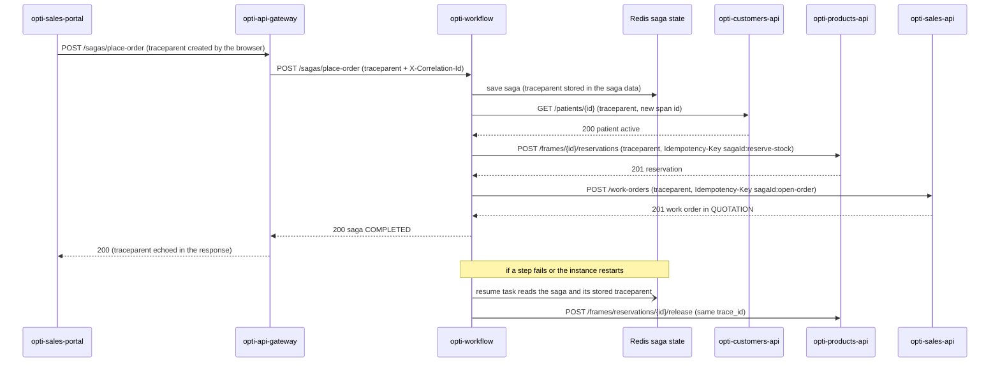

# CP1 - Critical journey and trace map

## Journey: place an order (saga `place-order`)

A seller opens a new sale in `portal-ventas` (HU-22, four-step wizard, `opti-sales-portal`). The
browser starts the saga `POST /api/v1/sagas/place-order` with an `Idempotency-Key`. `opti-workflow`
checks the patient, reserves the stock of the chosen product and opens the work order in
quotation (HU-08). If a step fails, the steps already done are compensated in reverse order.

Names used by the docs repo (`opti-docs`) and by the code repositories:

| Docs name (`05-architecture/overview.md`) | Code repository | Role in this journey |
|---|---|---|
| `portal-ventas` | `opti-sales-portal` | starts the saga |
| `api-gateway` | `opti-api-gateway` (nginx) | routes `/api/v1/sagas` to the workflow |
| saga orchestrator (not yet documented) | `opti-workflow` | runs the three steps and the compensations |
| `ms-pacientes` | `opti-customers-api` | `Patient` must be active |
| `ms-inventario` | `opti-products-api` | reserves a `Frame` (or lens, accessory, liquid) |
| `ms-ordenes` | `opti-sales-api` | opens the `WorkOrder` in `QUOTATION` |

## Hop table

| # | Caller | Callee | Protocol | Operation | Sync/Async | Data |
|---|---|---|---|---|---|---|
| 1 | `opti-sales-portal` | `opti-api-gateway` | REST | `POST /api/v1/sagas/place-order` | sync | none |
| 2 | `opti-api-gateway` | `opti-workflow` | REST | `POST /api/v1/sagas/place-order` | sync | Redis (saga state) |
| 3 | `opti-workflow` | `opti-customers-api` (`ms-pacientes`) | REST | `GET /api/v1/patients/{id}` | sync | `patients_schema` |
| 4 | `opti-workflow` | `opti-products-api` (`ms-inventario`) | REST | `POST /api/v1/frames/{id}/reservations` | sync | `inventory_schema` |
| 5 | `opti-workflow` | `opti-sales-api` (`ms-ordenes`) | REST | `POST /api/v1/work-orders` | sync | `orders_schema` (`WorkOrder` + invoice) |
| 6 | `opti-workflow` (resume task) | Redis | Redis protocol | reload saga in `RUNNING` / `COMPENSATING` | async | saga state |
| 7 | `opti-workflow` (resume task) | `opti-products-api` | REST | `POST /api/v1/frames/reservations/{id}/release` (compensation) | async | `inventory_schema` |

Hops 6 and 7 are the asynchronous boundary: a background task (`SAGA_RESUME_EVERY`, 30 s) picks up
a saga that stopped halfway, long after the original HTTP request returned.

## Sequence diagram with trace context



Today the platform only propagates `X-Correlation-Id` (see `CorrelationFilter` in every `-api`).
This workshop adds the W3C `traceparent` header next to it: `00-<trace_id 32 hex>-<span_id 16 hex>-01`.

## Span tree

```
place-order  [root, opti-workflow, trace_id T]
|- http POST /api/v1/sagas/place-order  [opti-api-gateway]
|  `- saga.place-order  [opti-workflow]
|     |- saga.step check-patient
|     |  `- http GET /api/v1/patients/{id}  [opti-customers-api]
|     |- saga.step reserve-stock
|     |  `- http POST /api/v1/frames/{id}/reservations  [opti-products-api]
|     `- saga.step open-order
|        `- http POST /api/v1/work-orders  [opti-sales-api]
`- saga.resume  [asynchronous boundary, same trace_id T, new span id, link to the stored traceparent]
   `- saga.compensate reserve-stock
      `- http POST /api/v1/frames/reservations/{id}/release  [opti-products-api]
```
