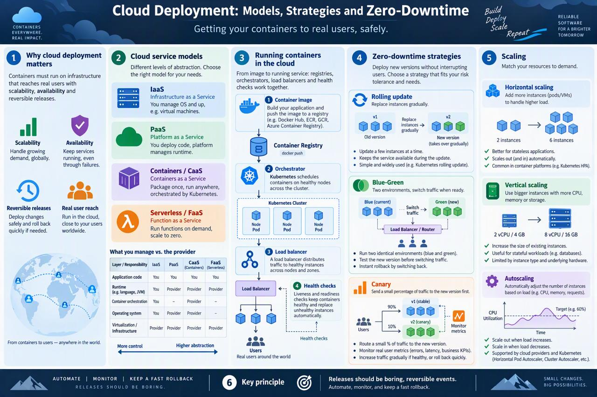

# Week 12 — Session 1: Cloud Deployment — Models, Strategies and Zero-Downtime

**Topic:** Cloud deployment of distributed systems
**Course:** Sistemas Distribuidos (2026-B, G1)

## Overview

Building containers is only half the job: they must run on infrastructure that reaches real users, scales with demand, stays available, and lets you release new versions without taking the system down. This session covers the **cloud service models** (IaaS, PaaS, containers, serverless), how to **run containers in the cloud**, the **zero-downtime deployment strategies** (rolling, blue-green, canary), and **scaling** — so that releases become boring, reversible events.

## Why Cloud Deployment Matters

A distributed system is useful only when users can reach it. The cloud provides on-demand infrastructure that gives three things a local server cannot easily offer: **scalability** (handle more load by adding capacity), **availability** (keep running despite failures), and **reversible releases** (ship and roll back safely). Good deployment turns a risky, manual event into an automated, predictable one.

## Cloud Service Models

The models differ in how much **you** manage versus how much the **provider** manages:

- **IaaS (Infrastructure as a Service):** you rent virtual machines, networks and storage; you manage the OS and everything above it. Maximum control, maximum responsibility. *Example: AWS EC2, Azure VMs.*
- **PaaS (Platform as a Service):** you deploy your code and the platform manages the runtime, OS and scaling. Less control, much less operational work. *Example: Heroku, App Service.*
- **Containers / CaaS:** you package the app once into an image and run it anywhere, orchestrated by **Kubernetes** or similar. A balance of portability and control. *Example: GKE, EKS, AKS.*
- **Serverless / FaaS (Functions as a Service):** you deploy functions that run on demand and **scale to zero** when idle; the provider handles everything else. *Example: AWS Lambda, Azure Functions.*

As you move from IaaS → serverless, you manage less and the provider manages more.

## Running Containers in the Cloud

The typical pipeline:

1. **Image in a registry** — the built container image is pushed to a registry (Docker Hub, ECR, GCR).
2. **Orchestrator schedules it** — Kubernetes (or similar) places containers on healthy nodes in the cluster.
3. **Load balancer sends traffic** — incoming requests are distributed across the running instances.
4. **Health checks keep them alive** — liveness and readiness probes ensure only healthy containers receive traffic; unhealthy ones are restarted or replaced.

## Zero-Downtime Deployment Strategies

The goal is to release a new version **without interrupting users**:

- **Rolling update:** replace instances gradually — a few at a time — so the service stays up throughout. Simple and widely used, but the old and new versions run side by side during the rollout.
- **Blue-Green:** keep two identical environments. "Blue" serves production while "Green" holds the new version; once Green is verified, switch all traffic to it. Instant switch and instant rollback, at the cost of running two environments.
- **Canary:** send a small percentage of traffic (e.g. 5%) to the new version first; watch metrics, then gradually increase if healthy. Limits the blast radius of a bad release.

## Scaling

- **Horizontal scaling (scale out):** add more instances to share the load. Preferred for distributed systems because it has no single-machine ceiling.
- **Vertical scaling (scale up):** give an instance more CPU/memory. Simple, but limited by the biggest machine available.
- **Autoscaling:** automatically add or remove instances based on load (e.g. CPU usage or request rate), so the system matches demand without manual intervention.

## Key Principle

**Releases should be boring, reversible events.** Automate the deployment, monitor the result, and always keep a fast rollback ready. A deployment that can be undone quickly turns risk into a routine, low-stress operation.

## Key Takeaways

- Cloud models trade control for convenience: **IaaS → PaaS → Containers → Serverless**.
- Containers run via **registry → orchestrator → load balancer → health checks**.
- Zero-downtime strategies: **rolling**, **blue-green**, **canary** — each limits risk differently.
- Scale **horizontally** by default, and use **autoscaling** to match demand.

## Infographic

