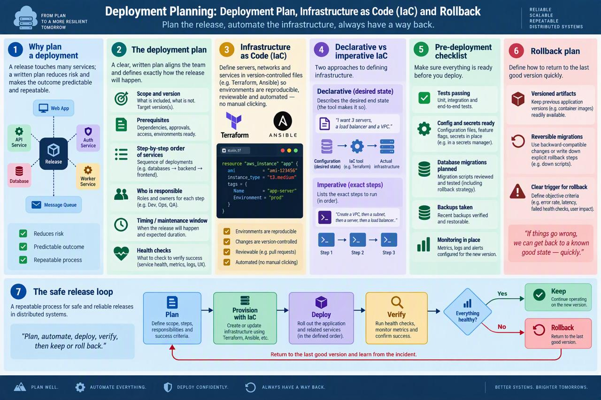

# Week 12 — Session 2: Deployment Plan, Infrastructure as Code (IaC) and Rollback

**Topic:** Planning a safe deployment
**Course:** Sistemas Distribuidos (2026-B, G1)

## Overview

Knowing the deployment *strategies* (Session 1) is not enough; a real release must be **planned**. This session covers writing a **deployment plan**, defining infrastructure with **Infrastructure as Code (IaC)** so environments are reproducible, and preparing a **rollback plan** so you always have a way back. The guiding idea: *plan the release, automate the infrastructure, and always have a way back.*

## Why Plan a Deployment

A release in a distributed system touches many services at once. Without a plan, steps are forgotten, order is wrong, and recovery is improvised. A **written deployment plan** reduces risk and makes the outcome **predictable and repeatable** — anyone on the team can follow it and get the same result.

## The Deployment Plan

A good plan states, clearly and in advance:

- **Scope and version** — what is being deployed and which version/tag.
- **Prerequisites** — approvals, dependencies and resources that must be ready first.
- **Step-by-step order of services** — the exact sequence in which services are deployed (e.g. database → backend → frontend).
- **Who is responsible** — the owner for each step and a point of contact if something fails.
- **Timing / maintenance window** — when the release happens and the expected impact.
- **Health checks to verify success** — the concrete checks (metrics, logs, smoke tests) that confirm the release worked.

## Infrastructure as Code (IaC)

**IaC** means defining servers, networks and services in **version-controlled files** instead of configuring them by hand.

- **Tools:** Terraform, Ansible, CloudFormation, Pulumi.
- **Benefits:** environments become **reproducible** (spin up an identical staging/prod), **reviewable** (changes go through pull requests), and **automated** (no manual clicking that nobody can repeat).
- Because the infrastructure lives in Git, you get history, review and rollback for infrastructure the same way you do for application code.

## Declarative vs Imperative IaC

Two ways to define infrastructure:

- **Declarative** — you describe the **desired end state** and the tool figures out how to reach it (e.g. Terraform: "there should be 3 servers"). Idempotent and self-healing.
- **Imperative** — you list the **exact steps** to run, in order (e.g. a shell script: "create server, then configure, then start"). More control, but you own the sequencing and edge cases.

Most modern IaC is declarative because it is safer and repeatable.

## Pre-Deployment Checklist

Before you deploy, confirm everything is ready:

- **Tests passing** — unit, integration and end-to-end are green.
- **Config and secrets ready** — environment configuration and secrets are in place for the target environment.
- **Database migrations planned** — migrations are written, tested and ideally reversible.
- **Backups taken** — recent backups of data and critical state exist and are verified.
- **Monitoring in place** — metrics, logs and alerting are ready so you can see the release's effect.

## Rollback Plan

Always define **how to return to the last good version quickly**:

- **Versioned artifacts** — keep previous versions of images and releases so you can redeploy an old one immediately.
- **Reversible migrations** — design database changes so they can be undone (backward-compatible when possible).
- **Clear trigger for rollback** — define, in advance, the objective criteria (e.g. error rate, failed health checks, business metric) that mean "stop and roll back — quickly and safely."

*If things don't go as expected, you can get back to a known good state quickly and safely.*

## The Safe Release Loop

A repeatable process for reliable releases:

1. **Plan** — define scope, order and checks.
2. **Provision with IaC** — create or update the infrastructure from code.
3. **Deploy** — release the new version using a zero-downtime strategy.
4. **Verify** — run health checks and watch metrics.
5. **Decide: Keep or Rollback** — keep it if healthy; roll back fast if not.

Then repeat for the next release.

## Key Takeaways

- A **written deployment plan** makes releases predictable and repeatable.
- **IaC** makes infrastructure reproducible, reviewable and automated — prefer **declarative**.
- A **pre-deployment checklist** catches problems before they ship.
- A **rollback plan** with versioned artifacts, reversible migrations and a clear trigger is non-negotiable.
- Follow the loop: **Plan → Provision → Deploy → Verify → Keep/Rollback**.

## Infographic

