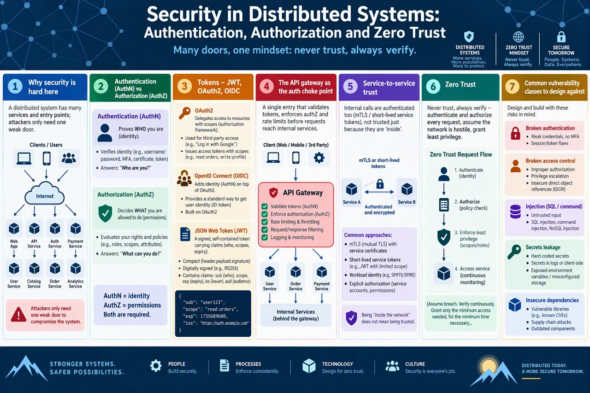
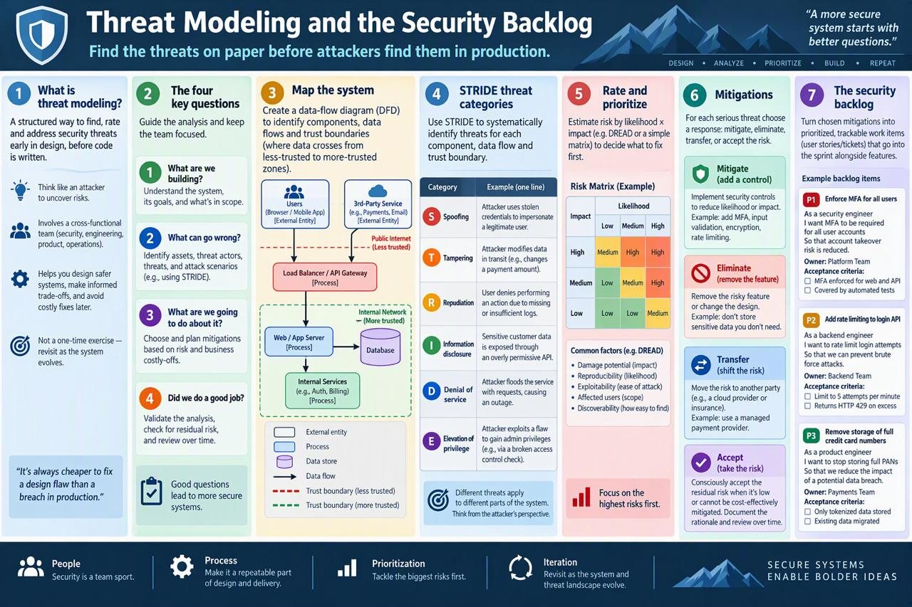

<!-- HU-STATUS TEMPLATE - do NOT remove the <!-- ... --> markers or the table headers.
     Your weekly grade is read AUTOMATICALLY from this file:
       13-week/hu-status/README.md  (inside YOUR fork). English. -->

# Weekly Status - Week 13

<!-- CONFIG-START - must match your profile repo (username/username) CONFIG -->
- FULL_NAME: Bairon Alexander Suarez Camacho
- GITHUB_USER: BackSua
- TEAM: The Illusionists
- SPRINT_GOAL: Understand security in distributed systems (authentication, authorization, zero trust) and how threat modeling turns risks into a security backlog; prepare the Corte 3 certification.
<!-- CONFIG-END -->

## 1. User stories worked this week
| HU ID | Title | Status (todo/doing/done) | Evidence (PR or commit URL) |
|---|---|---|---|
| N/A | Study deliverables: authN, authZ and zero trust; threat modeling and the security backlog | done | See section 6 |
| N/A | Corte 3 certification (Huawei HCCDP-Solution Architectures): base structure synced into the fork, course not started yet | todo | [`certification/`](../certification/README.md) |

## 2. My individual contribution

- Studied authentication against authorization, tokens (JWT, OAuth2, OIDC), the API gateway as the
  single point that validates tokens, service-to-service trust (mTLS, short-lived tokens, workload
  identity), zero trust and common vulnerability classes. Summary and infographic are in this folder.
- Studied threat modeling: the four key questions, data-flow diagrams and trust boundaries, STRIDE,
  risk rating, the four responses to a risk and how mitigations become security backlog stories.
  Summary and infographic are in this folder.
- Relevance to OptiView: `api-gateway` is meant to validate the JWT issued by Keycloak and forward
  `X-User-Id` and `X-User-Role`, while each service checks the role in its use case layer; patient
  data (document, optical formula) is the asset to protect first.
- Synced the `certification/` base structure from the course repository into the fork (only that
  folder, to avoid importing other students' work) and read the certification guide and the
  week 13 slides.

## 3. Blockers and risks

- The certification needs the teacher's class invitation, expected by 2026-10-28; the course
  (56 hours) must be completed with real evidence before 2026-11-15, so the study hours have to
  start this week.
- Security work for OptiView (threat model, backlog) is not written yet.

## 4. Plan for next week

- Join the Huawei class when the invitation is published and start the pre-class guidance and
  chapters 1 to 6, with dated screenshots.
- Draft a first threat model of `place-order` and of the payment authorization with STRIDE.

## 5. Compliance self-check
- [x] Conventional Commits - `type(scope): summary`
- [ ] Per-environment HU branch + PR to that environment (hu-xxx-dev -> develop, ...)
- [ ] Testable acceptance criteria
- [ ] Tests added/updated (unit / integration)
- [ ] DDD / hexagonal boundaries respected (domain has no I/O)
- [x] No secrets; config via environment variables

Notes on unchecked items:
- This week's deliverables are study documents, so no HU branch, tests or acceptance criteria apply.

## 6. Evidence links

- Session summary: [`security-authn-authz-zero-trust.md`](./security-authn-authz-zero-trust.md)
- Session summary: [`threat-modeling-security-backlog.md`](./threat-modeling-security-backlog.md)
- Infographic: 
- Infographic: 
- Certification folder: [`certification/`](../certification/README.md)
