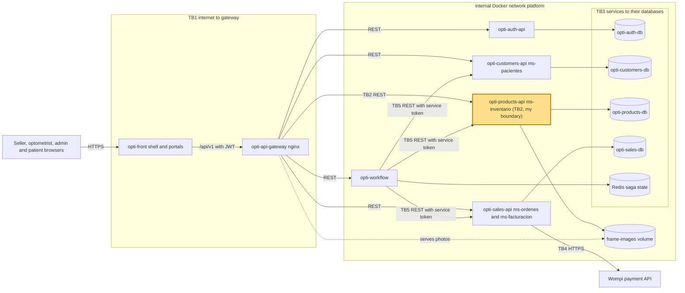

# CP1 - Attack surface map

System: OptiView (team The Illusionists). Names follow `05-architecture/overview.md` of `opti-docs`
(`api-gateway`, `ms-pacientes`, `ms-inventario`, `ms-ordenes`, `ms-facturacion`) with the repository
that implements each one. My boundary is **TB2**: `opti-api-gateway` to `opti-products-api`
(`ms-inventario`), claimed in issue 30 of `opti-docs`.

## Data flow and trust boundaries

| Id | Boundary | Mine |
|---|---|---|
| TB1 | internet (browsers) to `opti-front` and `opti-api-gateway` | no |
| TB2 | `opti-api-gateway` to `opti-products-api` | **yes** |
| TB3 | each service to its own PostgreSQL database and `opti-workflow` to Redis | no |
| TB4 | `opti-sales-api` to the external payment API (Wompi) | no |
| TB5 | `opti-workflow` to `opti-customers-api`, `opti-products-api` and `opti-sales-api` (service token) | no |

## Asset inventory

| Asset | Where it lives | Classification |
|---|---|---|
| Purchase price (`buyPrice`) and margin of each `Frame` and lens | `opti-products-db`, responses of `opti-products-api` | Confidential |
| Stock quantity and stock movements | `opti-products-db` | Internal |
| Stock reservations (`reservationId`, quantity, saga reference) | `opti-products-db`, calls from `opti-workflow` | Internal |
| Frame photos | `frame-images` volume of `opti-products-api` and the gateway | Internal |
| JWT public key (`JWT_PUBLIC_KEY`) and the service token of `opti-workflow` | environment of each service | Restricted |
| Access token of the user (JWT RS256 with role) | browser, `Authorization` header | Restricted |

Patient data (document, optical formula) does not live behind this boundary; it is behind TB3 of
`opti-customers-db` and is analysed by whoever claims that boundary.

## Entry points of TB2 (what `opti-products-api` exposes)

Authentication today: `opti-products-api` verifies the RS256 JWT itself with `JWT_PUBLIC_KEY`
(`AuthFilter`, `Rs256Verifier`); the gateway only rejects requests with no credential (401) and
limits 30 requests per second per IP (burst 60), with a body limit of 1 MB. `/health` is public.
`opti-docs` (`07-api/authentication.md`) describes the target where the gateway validates the token.

| Endpoint (same for `/lenses`, `/accessories`, `/liquids`) | Caller | Who may call it today |
|---|---|---|
| `POST /api/v1/frames` (create) | admin portal | role `ADMIN` |
| `POST /api/v1/frames/{id}/image` (photo upload) | admin portal | role `ADMIN` |
| `PUT /api/v1/frames/{id}/min-stock`, `POST /api/v1/frames/{id}/stock-entries` | admin portal | role `ADMIN` |
| `POST /api/v1/frames/{id}/reservations`, `POST /api/v1/reservations/{id}/release` | `opti-workflow` | `ADMIN` or `SERVICE` |
| `GET /api/v1/frames`, `GET /api/v1/frames/{id}`, `GET /api/v1/frames/summary`, `GET /api/v1/frames/{id}/movements` | every portal | any valid token |
| `GET /health` | health checks | public |
