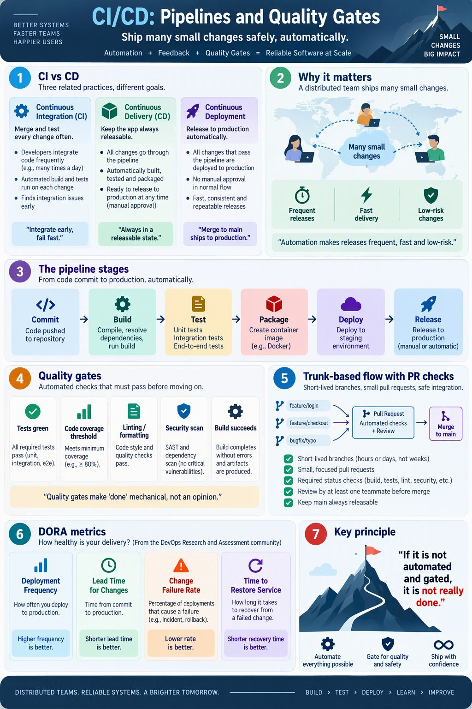
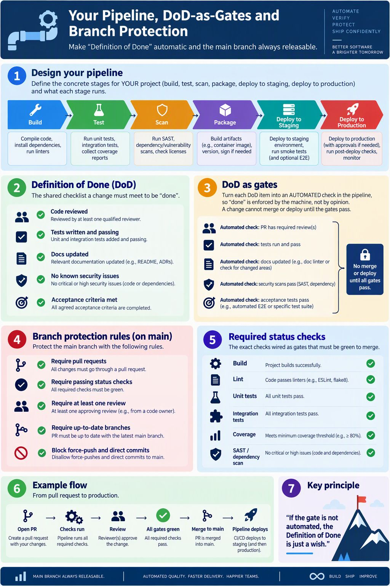

<!-- HU-STATUS TEMPLATE - do NOT remove the <!-- ... --> markers or the table headers.
     Your weekly grade is read AUTOMATICALLY from this file:
       14-week/hu-status/README.md  (inside YOUR fork). English. -->

# Weekly Status - Week 14

<!-- CONFIG-START - must match your profile repo (username/username) CONFIG -->
- FULL_NAME: Bairon Alexander Suarez Camacho
- GITHUB_USER: BackSua
- TEAM: The Illusionists
- SPRINT_GOAL: Understand CI/CD pipelines, quality gates and branch protection, and design the delivery pipeline of OptiView for MVP 3.
<!-- CONFIG-END -->

## 1. User stories worked this week
| HU ID | Title | Status (todo/doing/done) | Evidence (PR or commit URL) |
|---|---|---|---|
| N/A | Prescription PDF download in patient records | doing | [opti-customers-api@fc7cff8](https://github.com/code-corhuila/opti-customers-api/commit/fc7cff8d86e720bd16175a51392dd8df7a5995ce), [opti-customers-portal@8018d19](https://github.com/code-corhuila/opti-customers-portal/commit/8018d19969f809688dba9e8185f4b897cd131c01) |
| N/A | Product form validation and localized server errors | doing | [opti-products-api@cbcb523](https://github.com/code-corhuila/opti-products-api/commit/cbcb523d7a98bb4d936788822f1a9ec49fcfd31d), [opti-products-portal@c1ecd30](https://github.com/code-corhuila/opti-products-portal/commit/c1ecd30c407c564824698620b96822df0607aed2) |
| N/A | Study deliverables: CI/CD pipelines and quality gates; pipeline, DoD as gates and branch protection | done | See section 6 |
| N/A | Corte 3 certification (Huawei HCCDP-Solution Architectures): enrollment and chapters 1 to 4 | doing | [`certification/`](../certification/README.md), [5213f22](https://github.com/BackSua/sistemas-distribuidos-2026-b-g1/commit/5213f22e9e8f3b6859926c152cda0d1b6386fd3d) |

The two implementation rows are commits on the branch `feat/pdf-payments-validation` of the four code repositories (they have no HU id yet); `doing` means they are not merged into the environment branches.

## 2. My individual contribution

- Studied CI against CD against continuous deployment, the pipeline stages (commit, build, test, package, deploy, release), quality gates, trunk-based flow with pull request checks and the four DORA metrics. Summary and infographic are in this folder.
- Studied how to design the pipeline of a project, how the Definition of Done becomes automatic gates, and the rules of branch protection on `main` (pull request required, required status checks, one review, up-to-date branch, no force-push). Summary and infographic are in this folder.
- Relevance to OptiView: the `security.yml` of week 13 already has three gates (secret scan, dependency audit, negative authorization test); the next step is to add build, unit tests and lint as required checks in the `develop`, `qa` and `main` branches of each `opti-*` repository.
- Implementation work: prescription PDF download in `opti-customers-api` and `opti-customers-portal`, and complete product form validation with server field feedback in `opti-products-api` and `opti-products-portal`.

## 3. Blockers and risks

- The pull requests of the branch `feat/pdf-payments-validation` still need review and merge into `develop`; I do not merge my own work.
- The certification is at 24 % (chapters 1 to 4): the remaining chapters, the labs and the final exam must be finished before 2026-11-15.
- The repositories do not have required status checks yet, so branch protection is still a proposal.

## 4. Plan for next week

- Finish the certification evidence week by week and submit it in Moodle before 2026-11-15.
- Propose the required checks (build, test, lint, security) for the pull requests of `opti-products-api`.

## 5. Compliance self-check
- [x] Conventional Commits - `type(scope): summary`
- [ ] Per-environment HU branch + PR to that environment (hu-xxx-dev -> develop, ...)
- [ ] Testable acceptance criteria
- [ ] Tests added/updated (unit / integration)
- [ ] DDD / hexagonal boundaries respected (domain has no I/O)
- [x] No secrets; config via environment variables

Notes on unchecked items:
- The implementation commits are on a feature branch and are not yet promoted through the environment branches; the study deliverables have no HU branch, tests or acceptance criteria.

## 6. Evidence links

- Session summary: [`cicd-pipelines-quality-gates.md`](./cicd-pipelines-quality-gates.md)
- Session summary: [`pipeline-dod-gates-branch-protection.md`](./pipeline-dod-gates-branch-protection.md)
- Infographic: 
- Infographic: 
- Certification folder: [`certification/`](../certification/README.md)
