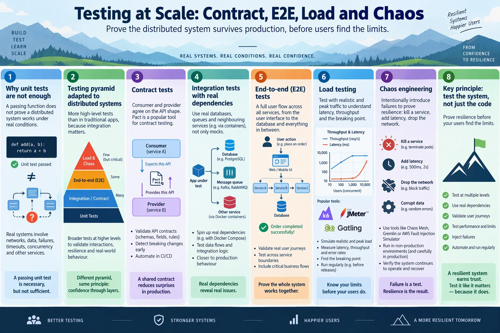
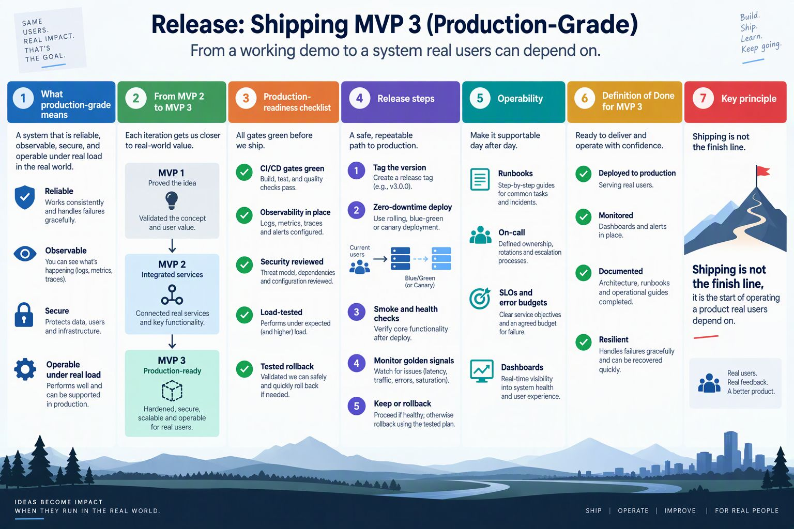

<!-- HU-STATUS TEMPLATE - do NOT remove the <!-- ... --> markers or the table headers.
     Your weekly grade is read AUTOMATICALLY from this file:
       15-week/hu-status/README.md  (inside YOUR fork). English. -->

# Weekly Status - Week 15

<!-- CONFIG-START - must match your profile repo (username/username) CONFIG -->
- FULL_NAME: Bairon Alexander Suarez Camacho
- GITHUB_USER: BackSua
- TEAM: The Illusionists
- SPRINT_GOAL: Understand how to test a distributed system at scale (contract, integration, E2E, load and chaos) and what a production-grade release of MVP 3 requires.
<!-- CONFIG-END -->

## 1. User stories worked this week
| HU ID | Title | Status (todo/doing/done) | Evidence (PR or commit URL) |
|---|---|---|---|
| N/A | Study deliverables: testing at scale (contract, E2E, load, chaos); shipping MVP 3 as a production-grade release | done | See section 6 |
| N/A | Corte 3 certification (Huawei HCCDP-Solution Architectures): chapters 1 to 4 done, chapters 5 to 14, labs and final exam pending | doing | [`certification/`](../certification/README.md) |

No implementation commits of mine are registered this week.

## 2. My individual contribution

- Studied why unit tests are not enough in a distributed system, the testing pyramid adapted to many services, contract tests, integration tests with real dependencies, end-to-end tests, load testing and chaos engineering. Summary and infographic are in this folder.
- Studied what production-grade means (reliable, observable, secure, operable), the production-readiness checklist, the release steps (tag, zero-downtime deploy, smoke checks, golden signals, keep or rollback) and the Definition of Done for MVP 3. Summary and infographic are in this folder.
- Relevance to OptiView: the hop table of the saga `place-order` (`opti-workflow` to `opti-customers-api`, `opti-products-api` and `opti-sales-api`) is where contract tests belong; the compensation of `reserve-stock` is the first chaos experiment (stop `opti-products-api` during a sale and check that the saga releases the stock); the rate limit of `opti-api-gateway` (30 requests per second) is the number to confirm with a load test.
- The observability work of week 11 (SLOs, alerts and runbook) and the security gates of week 13 are the base of the production-readiness checklist.

## 3. Blockers and risks

- The certification has chapters 5 to 14, four labs and the final exam pending before 2026-11-15; the online labs may need a Huawei Cloud account, which I must create myself.
- No load or chaos test has been run on OptiView yet; they are plans, not results.

## 4. Plan for next week

- Complete the certification evidence and submit it in Moodle before 2026-11-15.
- Write the first contract test between `opti-workflow` and `opti-products-api` for the reservation endpoint.

## 5. Compliance self-check
- [x] Conventional Commits - `type(scope): summary`
- [ ] Per-environment HU branch + PR to that environment (hu-xxx-dev -> develop, ...)
- [ ] Testable acceptance criteria
- [ ] Tests added/updated (unit / integration)
- [ ] DDD / hexagonal boundaries respected (domain has no I/O)
- [x] No secrets; config via environment variables

Notes on unchecked items:
- This week's deliverables are study documents, so no HU branch, tests or acceptance criteria apply.

## 6. Evidence links

- Session summary: [`testing-at-scale-contract-e2e-load-chaos.md`](./testing-at-scale-contract-e2e-load-chaos.md)
- Session summary: [`release-shipping-mvp3-production-grade.md`](./release-shipping-mvp3-production-grade.md)
- Infographic: 
- Infographic: 
- Certification folder: [`certification/`](../certification/README.md)
