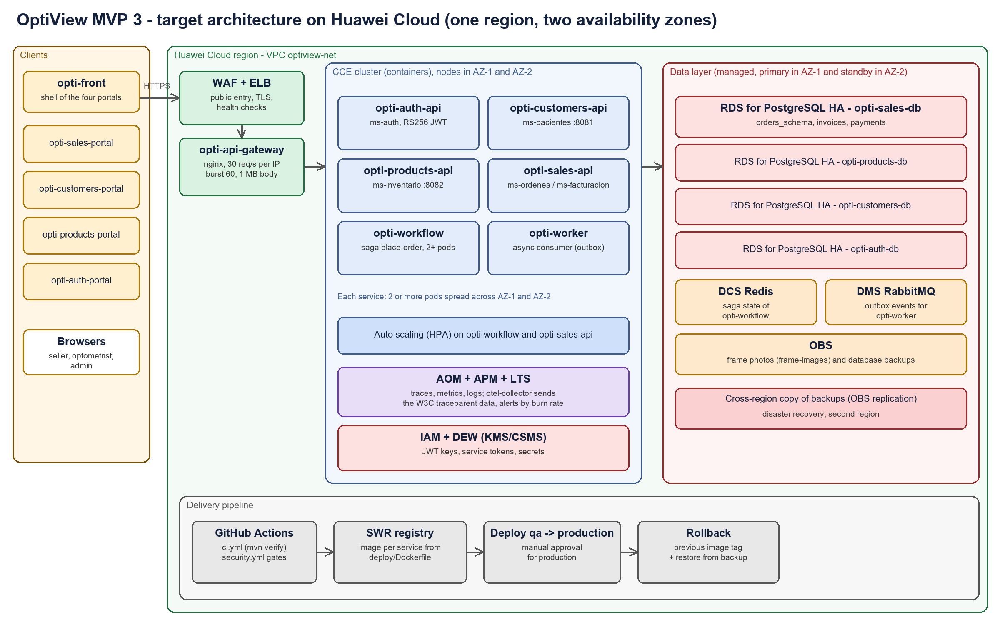

# Architecture design note — The Illusionists

This note redesigns OptiView, the optical store system of our team, for the third MVP on Huawei Cloud. Today the system runs as Docker containers on one host per environment (`05-architecture/deployment.md`). The goal here is a design that survives the loss of one availability zone, scales the services that carry the sale flow, and is deployed without manual steps. All numbers below are design decisions of this proposal; they are not measured results.

## 1. Target architecture

Traffic enters through a web application firewall and a load balancer, reaches `opti-api-gateway`, and from there the services that run in a container cluster with nodes in two availability zones. Each service owns its database, as ADR-003 decided, and the databases are managed PostgreSQL instances with a standby in the second zone. State and events live in managed Redis and RabbitMQ. Images, photos and backups live in object storage.

To see the diagram in use, follow one sale. A seller finishes the four-step wizard of `opti-sales-portal`, and the browser sends `POST /api/v1/sagas/place-order` to the load balancer. The gateway forwards it to `opti-workflow`, which asks `opti-customers-api` if the patient is active, asks `opti-products-api` to reserve the frame, and asks `opti-sales-api` to open the work order. If a pod of any of them dies in the middle, the load balancer sends the next call to the pod in the other zone, and `opti-workflow` resumes unfinished sagas from Redis every 30 seconds.

| Component in the diagram | Defined in (file of your team's -docs) |
|---|---|
| `opti-api-gateway` (nginx, rate limit, routing) | 09-microservices/services/01-api-gateway/README.md |
| `opti-auth-api` and its JWT | 07-api/authentication.md |
| `opti-customers-api` (`ms-pacientes`), `opti-products-api` (`ms-inventario`), `opti-sales-api` (`ms-ordenes`, `ms-facturacion`) | 05-architecture/overview.md |
| `opti-workflow` (saga `place-order`) and DCS Redis | 05-architecture/decisions/records/ADR-004-place-order-saga.md |
| `opti-worker` and DMS RabbitMQ (outbox) | 05-architecture/decisions/records/ADR-005-outbox-eventual-consistency.md |
| `opti-auth-db`, `opti-customers-db`, `opti-products-db`, `opti-sales-db` | 05-architecture/decisions/records/ADR-003-database-per-service.md |
| AOM, APM and LTS (observability) | 13-operations/observability.md |
| Environments and delivery pipeline | 10-devops/environments.md |

## 2. Five principles

| Principle | Current weakness | Evidence in -docs | Design decision | Huawei Cloud service |
|---|---|---|---|---|
| Reliability | One Docker host per environment is a single point of failure, and a stock reservation never expires if the saga dies after `reserve-stock` | 05-architecture/deployment.md and 05-architecture/security/stride-BackSua.md | Run two or more pods of every service in two zones, a standby database in the second zone, and an expiry job for reservations | CCE, RDS for PostgreSQL HA, ELB |
| Security | A service token can live up to 90 days and cannot be revoked; the gateway only checks that a credential exists | 05-architecture/security/stride-BackSua.md | Service tokens of a few days with rotation, JWT keys in a secret store, a firewall in front of the gateway | WAF, IAM, DEW (CSMS) |
| Performance efficiency | Sales reports read the same tables that the sale flow writes, so a report can slow a sale | 05-architecture/decisions/records/ADR-006-cqrs-sales-reports.md | Send reports to a read replica and cache the catalogue of products in Redis | RDS read replica, DCS Redis |
| Cost | Every environment has the same fixed size, although a single optical store has low traffic at night | 10-devops/environments.md | Use small nodes with a monthly commitment for the base load and let auto scaling add pods only in the busy hours | CCE node pools, Auto Scaling |
| Operations | Logs, metrics and traces exist in the code but nobody receives an alert when sales are only slow | 13-operations/observability.md | Send telemetry to one platform and alert on the burn rate of the latency objective, not only on errors | AOM, APM, LTS |

The reservation problem is the clearest case of why the principles must be read together. A second zone (reliability) is not enough if a dead saga keeps stock blocked forever, so the reliability decision also changes the code of `opti-products-api`.

## 3. Scalability

| Service | Scaling metric | Threshold (number and unit) | Min instances | Max instances |
|---|---|---|---|---|
| `opti-workflow` | Running sagas per pod (`workflow_sagas_running`) | 20 sagas per pod | 2 | 5 |
| `opti-sales-api` | Average CPU of the pods in 5 minutes | 65 percent | 2 | 6 |

`opti-workflow` is the orchestrator of every sale, so its load is the number of sagas in flight and not the CPU, which stays low while it waits for the other services (each call has a timeout of 5 seconds). `opti-sales-api` does real work in each request (work orders, invoices and payments), so CPU is a good signal there. The minimum of two keeps one pod in each zone. The gateway keeps its rate limit of 30 requests per second per IP, and the maximums are sized so the databases are not the first thing to break: each service uses a connection pool that has to stay under the limit of its RDS instance.

## 4. Disaster recovery

- Critical data store: `opti-sales-db`, because it holds the work orders, invoices and payments of the store.
- RTO: 30 minutes
- RPO: 5 minutes
- DR pattern (chapter 11): high availability across two zones in the main region, plus backups copied to a second region (cold standby).
- Why the pattern meets those numbers: the standby database in the second zone takes over in a few minutes when a zone fails, so the data loss is almost zero in that case. For the loss of the whole region, the incremental backups every 5 minutes give the RPO, and the 30 minutes of RTO are enough to restore the latest backup in the second region and point the services to it with the same container images.

This design does not protect against a bad migration that corrupts data in both zones at once, because the standby copies whatever the primary writes. For that case the only protection is the backup, and that is why the backups keep several days of history and the restore is part of the rollback in section 5. A second limit is that the second region is a cold standby: it costs almost nothing while idle, but the 30 minutes of RTO depends on the restore being practiced, so one restore test per quarter is part of the plan.

## 5. Automated deployment

| Stage | Trigger | Tool or service | File in your team's repositories |
|---|---|---|---|
| Build | Pull request to `develop`, `qa` or `main` | GitHub Actions with Maven | opti-products-api/.github/workflows/ci.yml |
| Test | Same pull request | `mvn -B verify` in the same job, plus the security gates of week 13 | opti-products-api/.github/workflows/ci.yml |
| Image | Push to `develop` | Docker Buildx, image sent to the registry (SWR in the target) | opti-products-api/.github/workflows/publish.yml and opti-products-api/deploy/Dockerfile |
| Deploy to qa | Merge to `qa` | Same container definition applied to the cluster | opti-products-api/deploy/compose.yml |
| Deploy to production | Manual approval after qa | Same image tag as qa, applied to the production cluster | opti-infra/compose.yml |
| Rollback | Failed smoke check or alert after the release | Redeploy of the previous image tag; restore from backup if a migration was involved | opti-infra/scripts/up.sh |

The three environments of `10-devops/environments.md` keep their meaning: `develop` builds the image and deploys to dev, `qa` is the staging step, and production needs a person to approve. What changes is that all three use the same image and only the configuration differs, which comes from environment variables and the secret store, never from the image.

Today the image is published with the tag `latest`. For a real rollback this is a weakness, because the previous version cannot be named. The change proposed here is to tag each image with the version of the release, so the rollback is a deploy of a known tag and not a rebuild.

## 6. Decisions

- [ADR-C3-01](ADR-C3-01.md): run the services on a container cluster in two availability zones, with managed databases that have a standby in the second zone.
- [ADR-C3-02](ADR-C3-02.md): tag every image with the release version and deploy the same tag to qa and production, so the rollback is a redeploy.
